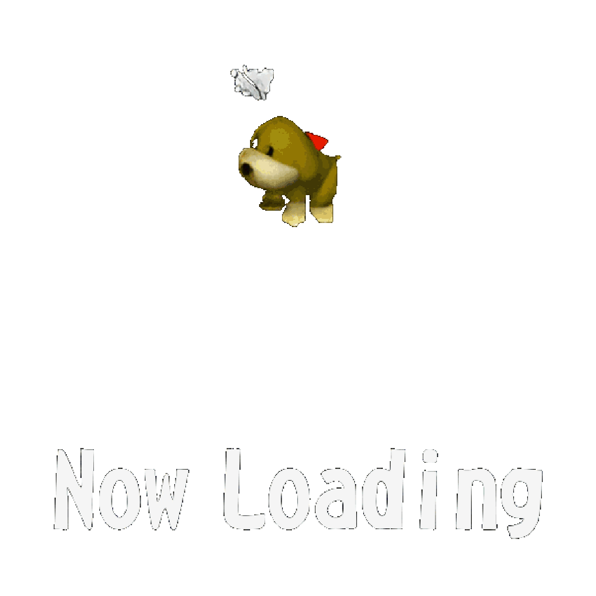
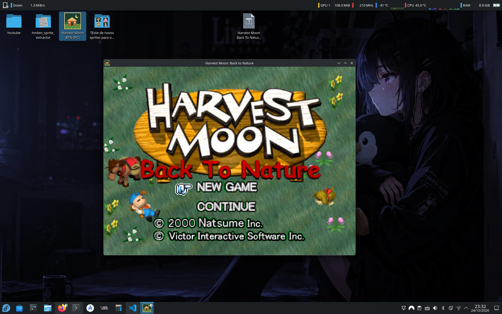
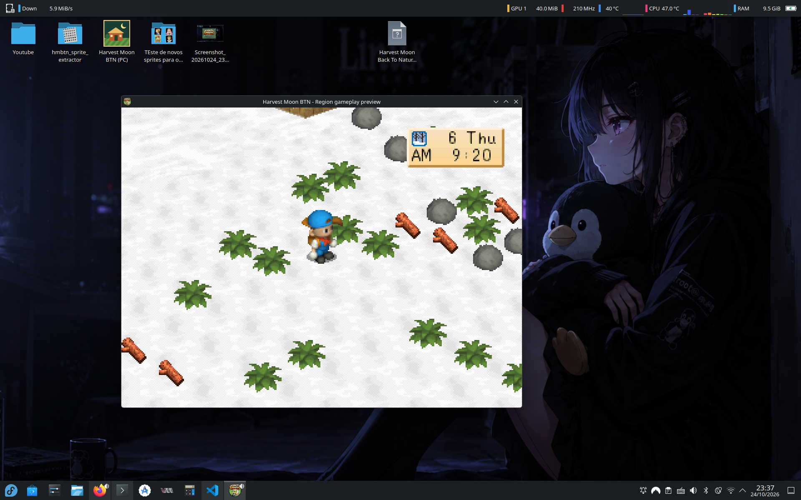

<div align="center">

# Harvest Moon: Back to Nature — PC Port

<a href="https://github.com/ViniciusJesus-art/HarvestMoonBTN-Port/releases/latest/download/HarvestMoonBTN-windows-x64-setup.exe">
  
</a>
</a>
&nbsp;&nbsp;&nbsp;
<a href="...">
<a href="https://github.com/ViniciusJesus-art/HarvestMoonBTN-Port/releases/latest/download/HarvestMoonBTN-linux-x86_64.AppImage">
  
</a>
</a>
&nbsp;&nbsp;&nbsp;
<a href="...">
<a href="https://github.com/ViniciusJesus-art/HarvestMoonBTN-Port/releases">
  
</a>


**Um projeto pessoal para portar Harvest Moon: Back to Nature (PlayStation) nativamente para Linux e Windows.**


**[ arquivos do jogo não esta incluido devido aos direitos autorais , na primeira instalação devera fornecer o .bin original ]**


*Baseado na decompilação [hmbtn-decomp](https://github.com/coalslav/hmbtn-decomp), de coalslav.*

> **Estado: port parcialmente jogável — título, abertura, casa, fazenda, vila, cultivo e saves nativos.** Os sistemas principais estão avançando, mas o jogo completo ainda não foi portado.

---




**Port ainda em Progresso...**

## Instaladores para PC

Os pacotes AppImage, DEB, RPM e EXE distribuem somente o porte e seu extrator nativo. No primeiro uso, selecione seu `.bin`; apenas os recursos são extraídos para a pasta do usuário. Python, SDK e emulador não são necessários. Veja [instalação e GitHub Actions](docs/port/INSTALLERS.md). O jogo completo ainda não está portado.

## Sobre o projeto


A proposta é estudar e adaptar o código C reconstruído de **Harvest Moon: Back to Nature** para executar em plataformas modernas sem depender de um emulador de PlayStation durante a execução. Pretendo preservar a experiência do jogo original e, futuramente, explorar melhorias e suporte a mods.

Este é um projeto pessoal, desenvolvido por interesse em programação, engenharia reversa e no próprio jogo. O port não é oficial e não possui afiliação com os titulares de Harvest Moon nem com os autores da decompilação.

</div>

## Sumário

- [Estado atual](#estado-atual)
- [Objetivos](#objetivos)
- [Arquitetura planejada](#arquitetura-planejada)
- [Plataformas](#plataformas)
- [Documentação](#documentação)
- [Compilação da decompilação original](#compilação-da-decompilação-original)
- [Origem e créditos](#origem-e-créditos)
- [Licenciamento e dados do jogo](#licenciamento-e-dados-do-jogo)

## Estado atual

O repositório inclui a decompilação correspondente à versão americana do PlayStation (`SLUS_011.15`) e um **port nativo independente em C11/SDL3** para Linux e Windows. O executável e os 13 overlays originais são preservados. O runtime de PC utiliza lógica adaptada em `port/`; ele **não** compila diretamente os módulos de jogo de `src/` nem emula o PS1.

### O que já funciona no recorte jogável

- **Apresentação e recursos:** resolução lógica de 320 × 240, título original, sprites e animações, texturas e cenários TMD, projeção/rasterização nativas, câmera, controles via SDL3 e reprodução parcial de músicas VAB/SEQ, efeitos e áudio XA.
- **Abertura e exploração:** cadastro do New Game, chegada à fazenda, infância, primeiro passeio de Thomas, apresentação de Zack, exploração de casa/fazenda/vila, regiões externas conectadas, portas, caminhada/corrida, alturas do terreno, interações e alguns eventos do original.
- **Relógio e passagem dos dias:** horário, calendário, estações, iluminação dia/noite, sono e atualizações diárias, além de clima e chuva no recorte atual.
- **Cultivo e economia:** inventário/ferramentas compartilhados, lojas, compra de sementes, preparo, plantio, rega, crescimento, colheita, remessa e pagamento. Nabo, batata, tomate, milho, cebola, berinjela, cenoura e batata-doce possuem percursos testados da compra até a venda. Grama inclui corte, rebrota e estoque de feno. Também foram integradas sementes sazonais de Won (repolho, abacaxi e pimentão).
- **Outros sistemas parciais:** galinhas, ovos, incubação e ração; moradores, agendas, conversas, presentes, afinidade, pesca, interações da casa e eventos selecionados.
- **Salvar e carregar:** saves nativos versionados para estados estáveis de exploração, com Continue e diário. Eventos e transições em andamento não podem ser salvos no meio; saves de memory card do PS1 não são importados.
- **Distribuição:** fluxos AppImage, DEB, RPM e EXE. O usuário fornece seu próprio BIN no primeiro uso; os recursos proprietários não são distribuídos.

### Desenvolvimento e testes

O roadmap registra **MA-01–06 e PF-01–05 concluídas; PF-06 em andamento**, com muitos sistemas do original ainda pendentes. A última validação Linux Debug documentada passou em **109/109 CTests** (incluindo testes opcionais com recursos locais do usuário). Isso não comprova validação em Windows real nem fidelidade completa ao PS1. Consulte o [status atualizado](docs/port/ROADMAP_STATUS.md), o [roadmap](docs/port/ROADMAP.md) e a [matriz de funcionalidades](docs/port/PORTING_MATRIX.md).

**Ainda incompleto:** progressão integral do jogo, todos os eventos/festivais, todas as espécies de animais, casamento/família, todas as lojas/ferramentas/áreas, fidelidade audiovisual total, mods e Android. Parte das funcionalidades acima cobre apenas cenários específicos de teste. **O port ainda não corresponde ao jogo completo.**

Para testar trechos diretamente, há `--scene-preview`, `--intro-preview`, `--childhood-preview`, `--house-preview` e `--diagnostics`. Mais detalhes em [abertura](docs/port/FARM_INTRO.md), [mapa](docs/port/WORLD_MAP.md), [cultivo](docs/port/PF02_CROP_CYCLE.md) e [saves nativos](docs/port/PF05_NATIVE_SAVES.md).

---

<br>


 ### Começar no Linux e Windows

 Requisitos: CMake 3.20+, compilador C11, Ninja e SDL3 de desenvolvimento.
 Se SDL3 não estiver instalado, o CMake baixa a versão fixada e confere seu hash; o primeiro build precisa de internet.
 No Windows, execute em um Developer PowerShell do Visual Studio com as ferramentas C++ e Ninja disponíveis.

Veja também o fluxo offline e sem Ninja no [guia de compilação](docs/port/BUILDING.md).

<br clear="all">

```bash
cmake --preset native-debug
cmake --build --preset native-debug
ctest --preset native-debug
```

Execute `./build/native-debug/port/hmbtn_native` no Linux ou `.\build\native-debug\port\hmbtn_native.exe` no Windows. O programa procura `data/` junto ao executável e no layout do projeto; `--data DIR` é prioritário. Enter abre o menu, setas selecionam e Enter/Z confirma. X/Backspace retorna do aviso de destino ainda não portado. `--window-test` abre o diagnóstico sem dados e `--diagnostics` verifica somente o console, sem display. Veja também [Windows e compilação cruzada](docs/port/WINDOWS.md).

## Objetivos

- Portar a lógica do jogo para uma aplicação nativa em Linux e Windows.
- Criar uma camada de compatibilidade para gráficos, áudio, entrada, temporização, memória e arquivos do PS1.
- Manter, na medida do possível, o código decompilado isolado das adaptações multiplataforma.
- Preservar uma forma de acompanhar as atualizações da decompilação original.
- Avaliar suporte a mods e melhorias apenas depois que o jogo básico estiver funcionando.

## Arquitetura planejada

| Camada | Responsabilidade | Estado |
|---|---|---|
| `src/` | Lógica decompilada do jogo | Base existente |
| `port/core/` | Aplicação host e formatos de dados PS1 | Base compilável |
| `port/game/` | Estado, exploração, cultivo, eventos e saves | Diversos sistemas jogáveis; progressão incompleta |
| `port/tests/` | Formatos, importação, janela e eventos | Implementado |
| `port/graphics/` | Bancos, animações, modelos TMD e sprites projetados | Título e chegada implementados parcialmente |
| `port/audio/` | Sampler VAB/ADPCM e sequenciador SEQ do título | Implementação parcial; reverb pendente |
| `port/input/` | Atalhos e tradução para botões PS1 | Teclado/gamepad implementados |
| `port/filesystem/` | Leitura de recursos e arquivos de save nativos | Implementado no recorte atual |
| `port/platform/` | Janela/renderizador SDL3 | Implementado |

**SDL3 foi integrado à infraestrutura de janela, eventos e apresentação.** A tradução dos gráficos PS1 e a adaptação da lógica ainda dependem do estudo de PSY-Q, endereços fixos, overlays e estruturas específicas do console. Veja os marcos no [roteiro](docs/port/ROADMAP.md).

O build original continua organizado pelos `CMakeLists.txt` e pelo toolchain PS1 existentes. O build nativo usa `-DHMBTN_BUILD_NATIVE=ON` e diretório separado, selecionado antes do toolchain PS1. Sem essa opção, o fluxo PS1 permanece selecionado.

## Plataformas

| Plataforma | Objetivo | Estado |
|---|---|---|
| Fedora / Linux | Primeira plataforma de desenvolvimento | Janela validada em Wayland e X11 |
| Windows | Build nativo de PC | MinGW x64 e Wine verificados; Windows real/MSVC pendentes |


## Documentação

- [Compilação Linux e Windows](docs/port/BUILDING.md)
- [Build Windows e pacote portátil](docs/port/WINDOWS.md)
- [Recorte do fluxo do título](docs/port/TITLE_FLOW.md)
- [Auditoria inicial do código PS1](docs/port/INITIAL_AUDIT.md)
- [Plano técnico de desenvolvimento](docs/port/ROADMAP.md)
- [Arquitetura inicial](docs/port/ARCHITECTURE.md)
- [Guia de contribuição e sincronização com upstream](CONTRIBUTING.md)
- [Decompilação original](https://github.com/coalslav/hmbtn-decomp)

## Compilação da decompilação original

O comando abaixo **compila para PlayStation 1**, não para Linux ou Windows. Requer Docker e as ferramentas instaladas pela imagem do projeto de origem:

```bash
docker build -t hmbtn-build .
docker run --rm --user "$(id -u):$(id -g)" -v "$PWD":/src:ro -v /tmp/hmbtn-build:/build \
  hmbtn-build bash -c 'cmake -S /src -B /build -G Ninja && cmake --build /build --target check'
```

A verificação `check` confere os hashes dos 14 binários originais. **Quando o port ou alterações de gameplay começarem, os hashes originais não serão mais uma verificação válida para os binários modificados.** Para reconstruir a imagem de disco no fluxo original é necessária uma cópia própria do disco; consulte a documentação upstream.








## Origem e créditos

Este repositório é um **fork** de [coalslav/hmbtn-decomp](https://github.com/coalslav/hmbtn-decomp). A decompilação e sua estrutura inicial foram produzidas pelo projeto original. O desenvolvimento do port será realizado separadamente e o histórico de autoria será preservado.

Agradecimentos aos autores da decompilação, aos criadores das ferramentas utilizadas e aos desenvolvedores do jogo original.

## Licenciamento e dados do jogo

A licença [CC0 1.0](LICENSE) do upstream cobre **somente o trabalho próprio do repositório original**. Componentes como `tools/maspsx` podem ter licença própria. O jogo, seus gráficos, músicas, recursos e o SDK PSY-Q pertencem a seus respectivos titulares e não são liberados pela CC0.

O port não deve publicar cópias do jogo ou dados proprietários sem autorização. Pretende-se estudar um processo no qual cada usuário fornece os recursos da sua própria cópia do jogo. A distribuição pública de um port com tais recursos exige análise dos direitos aplicáveis.

Música, passos, TV, calendário, baú de ferramentas e livro/estante estão descritos em [HOUSE_INTERACTIONS.md](docs/port/HOUSE_INTERACTIONS.md).
