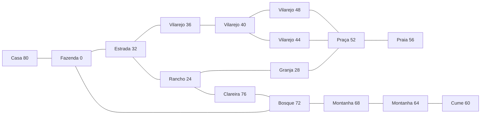

# Exploração das regiões externas

O controle livre conecta a fazenda às 14 regiões externas regulares: acessos
aos ranchos, ruas do vilarejo, praça, praia, bosque e trilhas da montanha até
o cume. São 15 regiões contando a fazenda, nas quatro estações. Os interiores
e os sistemas próprios de cada local não são considerados implementados
apenas porque seus modelos aparecem no mapa.

## Conexões

Os destinos, retângulos de passagem e coordenadas de chegada vêm dos registros
`FarmZone` importados. Não foram criados portais ou pontos de chegada manuais.
O quadro usa os identificadores lógicos da primavera; `world_map.c` resolve
as seções de verão/outono/inverno conforme a data da sessão.



A casa continua usando sua porta com Z/Cross. As outras conexões desse
grafo são passagens ao caminhar: fade de 10 ticks, carga no escuro e fade de
retorno. O relógio para durante a transição, e o controle volta na chegada.
A consulta ao terreno ajusta a altura sem alterar X/Z serializados.
O caminho de controle usa o chão original para caminhar e correr, inclusive
em escadas e encostas. Os limites assinados em `clampMin/clampMax`, usados
por `scene_clamp_result`, limitam a câmera sem limitar a posição do jogador.

Mochila, mão, ferramentas, terreno e valor pendente de vendas pertencem à
sessão e são conservados ao viajar. Objetos lançados na fazenda não são
desenhados em outras regiões. O encontro inicial não se repete no retorno.

## Placas e música

Z/Cross lê as placas originais, respeitando alcance, direção e altura.
As mensagens vêm do banco 2 e pausam o relógio. A placa para a fazenda
expande o nome cadastrado, incluindo nomes de oito caracteres.
Há 18 placas neste percurso; no verão são 17, conforme a seção original.

`farm_track_id` seleciona a faixa sazonal nos lugares apropriados, 27 no
vilarejo e 25/24 na praia de dia/noite. O volume conserva as exceções da
montanha, águas termais e cume, além do silêncio noturno no inverno.
As SEQs da praia exigem pitch wheel: o sequenciador agora aplica o comando
às notas novas e em execução, usando os limites por tom `pbmin/pbmax` de
`VagAtr`, documentados na [referência original da biblioteca](https://psx.arthus.net/sdk/Psy-Q/DOCS/LibRef47.pdf).
Nenhum SDK foi adicionado ou ligado ao porte nativo.

## Validação local e limites

Atalhos de sessão nova, sem cadastro, abertura ou visita de Thomas:

```bash
# Do lado de fora da casa
./build/native-debug/port/hmbtn_native --data data --farm-preview
# Praça
./build/native-debug/port/hmbtn_native --data data --area-preview 52
# Praia
./build/native-debug/port/hmbtn_native --data data --area-preview 56
# Cume da montanha
./build/native-debug/port/hmbtn_native --data data --area-preview 60
```

`--area-preview` aceita 0, múltiplos de 4 entre 24 e 76 e os interiores
92/96/112, descritos em [FARM_INTERIORS.md](FARM_INTERIORS.md), e múltiplos de
quatro entre 128 e 212, descritos em [VILLAGE.md](VILLAGE.md). Cada região usa
uma chegada real de suas passagens; a fazenda começa na saída da casa.
O controle e os sistemas já integrados ficam disponíveis. Os atalhos não
carregam saves nem concedem produtos e não alteram a abertura normal.
Use `--preview-date ESTAÇÃO:DIA --preview-time HH:MM` para selecionar a data/hora
do atalho (estação 0..3, dia 1..30). Por exemplo, `0:3` e `12:00` iniciam na
terça-feira 3 da primavera, ao meio-dia. A variante sazonal acompanha a data.
Use `--help` para consultar os parâmetros. Não combine dois modos de prévia.

Por preferência do usuário, esta etapa valida **somente Linux local**.
As mudanças usam C11, SDL3 e leituras little-endian já compartilhadas entre
Linux/Windows; não foi realizado outro cross-build Windows.

Os 27 CTests sem recursos passaram. O percurso opcional percorre as 34
passagens direcionais em cada estação, renderiza as regiões, lê as placas,
verifica altura na chegada, ausência de retorno imediato, pausas e conservação
do estado. Também mistura PCM real das duas faixas da praia e verifica o
silêncio noturno no inverno. Passeio de Thomas, relógio/sono e vendas foram
revalidados separadamente. Para repetir com os dados extraídos locais:

```bash
cmake --preset native-debug
cmake --build --preset native-debug
ctest --preset native-debug
SDL_VIDEO_DRIVER=dummy SDL_RENDER_DRIVER=software SDL_AUDIO_DRIVER=dummy \
  ./build/native-debug/port/hmbtn_world_map_playthrough data
```

Um terceiro argumento seleciona uma pasta existente para capturas BMP.
O driver pode ser registrado no CTest com `HMBTN_TEST_GAME_DATA`. Evidências
locais ignoradas pelo Git: `build/native-debug/world-map-playthrough.log`,
`world-map-x11.log` e `world-captures/`.

Os três interiores iniciais da fazenda estão ligados; veja
[FARM_INTERIORS.md](FARM_INTERIORS.md). Ainda faltam interiores da vila, seus horários e eventos,
moradores em exploração livre, cultivos, coleta silvestre, pesca, banhos,
camadas de mina e remapeamentos de festivais. Entradas para destinos ainda
não adaptados conservam o controle, permitindo retornar. Os blits de textura
animada da água ainda não estão ligados. Persistência em saves e comparação
visual completa com PS1 continuam pendentes. O bootstrap `--diagnostics`
não executa o jogo; a validação host não substitui o build PS1 e seu SHA-1.

A coleta silvestre dos quatro runs do bosque/montanha foi integrada depois
deste percurso: [POULTRY.md](POULTRY.md). Produtos coletados abastecem a mesma
mochila e caixa de venda; pedras/tocos que exigem ferramentas, minas, pesca
e banhos continuam pendentes.
